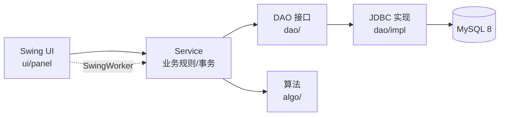

# BankManager

> 基于 **Java Swing + MySQL** 的银行管理系统 —— 从 2022 年数据结构课程设计重构而来。

<p align="center">
  <a href="./LICENSE"></a>
  <a href="./.github/workflows/ci.yml"></a>
  
  
  
</p>

## 目录

- [项目简介](#项目简介)
- [重构前后对比](#重构前后对比)
- [功能](#功能)
- [快速开始](#快速开始)
- [配置说明](#配置说明)
- [架构](#架构)
- [数据库设计](#数据库设计)
- [核心实现](#核心实现)
- [测试与 CI](#测试与-ci)
- [常见问题](#常见问题)
- [贡献与许可](#贡献与许可)

## 项目简介

一个桌面银行管理信息系统：职员与客户档案管理、存取贷与转账、VIP/普通双队列叫号、网点最短路径导航、操作日志查询。界面使用 Swing + FlatLaf，数据存于 MySQL 8。

原始版本是 2022 年秋「数据结构」课程大作业（单文件 782 行的 `BankManger` + 手工 `lib/*.jar`）。本仓库在保留原提交历史的前提下做了完整工程化重构。

## 重构前后对比

| 维度 | 2022 原版 | 现在 |
|---|---|---|
| 构建 | IDEA `.iml` + 手工 `lib/*.jar` | Maven，`mvn verify` 一条命令 |
| 源码编码 | GBK（含 1 个编码损坏文件） | 全部 UTF-8 |
| 数据库口令 | 硬编码 `root/123321` | `config.properties` / 环境变量 |
| 用户密码 | 明文入库存库 | BCrypt 哈希 |
| SQL | 31 处字符串拼接，可注入 | 全部 `PreparedStatement` |
| 表结构 | 6 张表，无主键/索引/外键 | 7 张表，主键 + 索引 + 外键 |
| 金额类型 | `double(16,2)` | `DECIMAL(16,2)` / `BigDecimal` |
| 分层 | 默认包，UI 里写 SQL | config → db → dao → service → ui |
| 线程模型 | 查库阻塞 EDT，界面卡死 | 全部走 `SwingWorker` |
| 最短路径 | 邻接矩阵 O(V²) 线性扫描 | 邻接表 + 优先队列 O((V+E)logV) |
| 测试 | 0 | 110 个（JUnit 5 + H2） |
| CI | 无 | GitHub Actions |

## 功能

**档案管理** — 职员的增删改查、客户账户管理（VIP/普通标识，余额与贷款只读，只能通过业务变动）。

**业务办理** — 存款、取款、贷款、还款、转账、利息试算。金额上限 1 亿、最多两位小数；余额不足、向自己转账都会被拒绝。

**排队叫号** — 普通与 VIP 双队列，取号后按先来后到叫号，记录窗口号与叫号时间，办结归档。

**网点导航** — 在无向带权网点图上计算最短路径，输出途经网点与总距离。

**操作日志** — 所有资金操作在同一事务内写入日志，按时间倒序查看。

## 快速开始

### 1. 准备数据库

需要 MySQL 8.0+：

```bash
mysql -u root -p < db/schema.sql
mysql -u root -p < db/seed.sql      # 可选：演示数据
```

### 2. 配置连接

```bash
cp config.properties.example config.properties
# 修改 db.user / db.password
```

也可以直接用环境变量（优先级高于配置文件）：

```bash
export BANK_DB_URL='jdbc:mysql://localhost:3306/bank_manager?useSSL=false&serverTimezone=Asia/Shanghai&characterEncoding=UTF-8'
export BANK_DB_USER=root
export BANK_DB_PASSWORD=your-password
```

### 3. 运行

```bash
mvn -q -B package
java -jar target/bank-manager-2.0.0-SNAPSHOT.jar        # 浅色主题
java -jar target/bank-manager-2.0.0-SNAPSHOT.jar --dark # 深色主题
```

也可以直接 `mvn exec:java -Dexec.mainClass=com.bankmanager.App`。

### 演示账号

导入 `db/seed.sql` 后可使用：

| 账号 | 密码 | 角色 |
|---|---|---|
| `admin` | `123456` | 管理员 |
| `teller` | `teller123` | 柜员 |

客户账户密码统一为 `123456`。**部署到真实环境前请务必修改。**

## 配置说明

| 配置项 | 环境变量 | 默认值 | 说明 |
|---|---|---|---|
| `db.url` | `BANK_DB_URL` | `jdbc:mysql://localhost:3306/bank_manager?...` | JDBC 连接串 |
| `db.user` | `BANK_DB_USER` | `root` | 数据库用户 |
| `db.password` | `BANK_DB_PASSWORD` | 空 | 数据库口令 |
| `db.poolSize` | `BANK_POOL_SIZE` | `5` | HikariCP 最大连接数 |

## 架构



- **ui** 只依赖服务接口，不碰 SQL；所有数据库调用放在 `Async`（`SwingWorker`）里，避免阻塞 EDT。
- **service** 负责校验、事务边界与日志；存取贷/转账通过 `Database.inTransaction` 保证原子性。
- **dao** 只做参数化查询与行映射，`DaoException` 统一包装 `SQLException`。
- **algo** 与数据库无关，可独立单测。

```
src/main/java/com/bankmanager/
├── App.java                 # 入口：配置 → 数据源 → DAO/服务装配 → 登录窗口
├── algo/                    # Graph（邻接表）、Dijkstra（优先队列）
├── config/                  # 环境变量 > config.properties > 默认值
├── db/                      # HikariCP 数据源、事务模板、异常
├── domain/                  # record 领域模型
├── dao/ + dao/impl/         # 接口与 JDBC 实现
├── service/ + service/impl/ # 业务服务
└── ui/                      # 登录、主窗口、六个页签、对话框、异步工具
```

## 数据库设计

```mermaid
erDiagram
    APP_USER {
        bigint id PK
        varchar username
        varchar password_hash
        enum role
    }
    EMPLOYEE {
        varchar id PK
        varchar name
        varchar tele
        varchar position
    }
    CUSTOMER {
        varchar card PK
        varchar name
        varchar password_hash
        enum type
        decimal balance
        decimal loan
    }
    QUEUE_TICKET {
        bigint id PK
        int number
        boolean vip
        enum status
        int counter_no
    }
    OPERATION_LOG {
        bigint id PK
        timestamp created_at
        varchar username
        varchar action
    }
    BANK_NODE ||--o{ BANK_EDGE : from
    BANK_NODE ||--o{ BANK_EDGE : to
```

完整 DDL 见 [`db/schema.sql`](db/schema.sql)，演示数据见 [`db/seed.sql`](db/seed.sql)。

## 核心实现

### 最短路径：邻接表 + 优先队列

```java
Optional<Dijkstra.Path> path = Dijkstra.shortest(graph, fromId, toId);
```

- 图在 `algo/Graph` 中构建：重复边保留较小权重，自环忽略，`distance <= 0` 直接拒绝。
- `algo/Dijkstra` 使用 `PriorityQueue` + 懒惰删除，复杂度 **O((V+E)logV)**；距离用 `BigDecimal`（保留两位），避免浮点误差。
- `DefaultRouteService` 每次调用重新加载图，增删网点后立即生效。

### 排队：数据库队列 + 行锁

取号与叫号都在事务中完成：`SELECT ... FOR UPDATE` 锁住队首票据后再更新状态，防止两个窗口同时叫到同一个人；取号号码按「同一天 + 同一队列」自增。

### 资金操作：单事务 + 同事务日志

```java
database.inTransaction(conn -> {
    customerDao.updateBalance(card, newBalance);
    logDao.append(user, "取款", amount + " 元");
    return null;
});
```

任何一步失败整笔回滚——包括日志写入失败。

## 测试与 CI

```bash
mvn -B verify
```

- **110 个测试**：算法 31、DAO 32（H2 内存库，MySQL 兼容模式）、业务服务 47（含真实事务回滚测试）
- 覆盖：最短路正确性与复杂度对照、取号/叫号并发语义、越权与非法金额、转账款一致性、BCrypt 不出明文
- CI：GitHub Actions 在 JDK 17 上跑 `mvn verify`，并上传 surefire 报告

## 常见问题

**启动提示「无法连接数据库」？**
检查 MySQL 是否启动、`db.url` 的库名是否为 `bank_manager`，以及账号是否有该库权限。

**`Public Key Retrieval is not allowed`？**
连接串需要 `allowPublicKeyRetrieval=true`（`config.properties.example` 已包含）。

**忘记管理员密码？**
用 BCrypt 生成新哈希后更新 `app_user.password_hash`，或重新导入 `db/seed.sql`（会覆盖数据）。

**为什么金额不用 `double`？**
二进制浮点无法精确表示 0.1 这类十进制小数，累计会产生分位误差；本项目统一用 `DECIMAL(16,2)` + `BigDecimal`。

**排队号码为什么每天从 1 开始？**
号码按「同一天 + 同一队列」计算最大值 +1，符合线下网点的取号习惯。

## 贡献与许可

欢迎提 Issue / PR。提交前请确认 `mvn verify` 通过。

[MIT License](LICENSE) © 2022 YuRuiH
